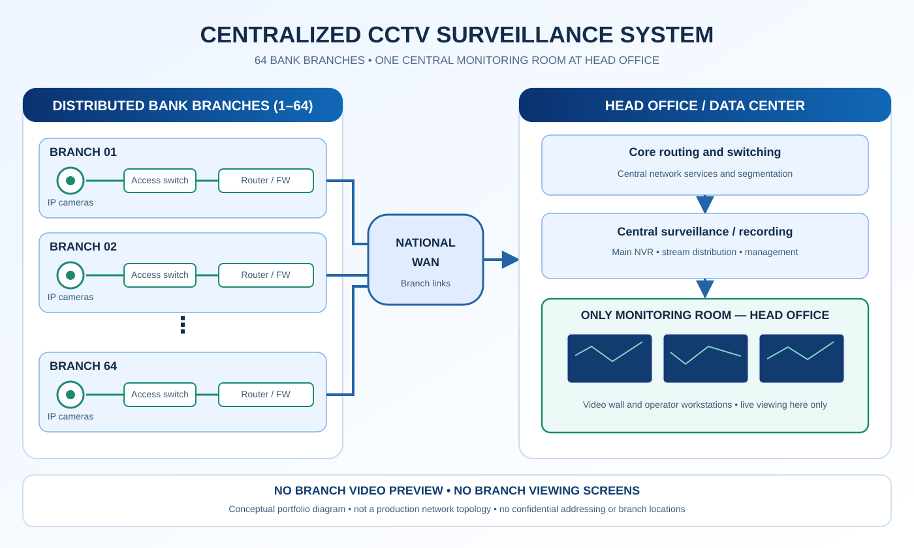

# Vidéosurveillance bancaire centralisée — 64 agences

**Rôle :** ingénieur principal · **Périmètre :** 64 agences bancaires · **Livraison :** moins de deux semaines selon le chef de projet.

## Principe fondamental

**Les agences possèdent des caméras IP et des équipements réseau, mais aucun écran de visualisation local. Toutes les images en direct et les stations d'opérateurs sont regroupées dans une seule salle de supervision au siège.**

## Présentation

Conception et pilotage de la mise en place d'une infrastructure de vidéosurveillance IP centralisée reliant 64 agences à une plateforme commune d'enregistrement et de supervision située au siège.

## Responsabilités

- Sélection des caméras et équipements d'enregistrement.
- Architecture réseau multisite et segmentation VLAN.
- Configuration des équipements, intégration ONVIF et RTSP.
- Optimisation de la bande passante et de la distribution vidéo.
- Préparation de l'unique salle de supervision du siège.
- Coordination des équipes d'installation, essais et réception.

**Flux :** caméras dans les agences → réseaux locaux → WAN → cœur réseau du siège → enregistrement central et distribution → salle de supervision du siège.

Le dessin est conceptuel, et non un plan exact de production. Aucun nom de banque, identifiant, adresse interne réelle ou configuration confidentielle n'est publié.

[Étude de cas FatihMH](https://fatihmh.online/fr/surveillance-bancaire-centralisee-64-agences/)

© 2026 Elfatih Mohamed Hameid Farah — Tous droits réservés.
